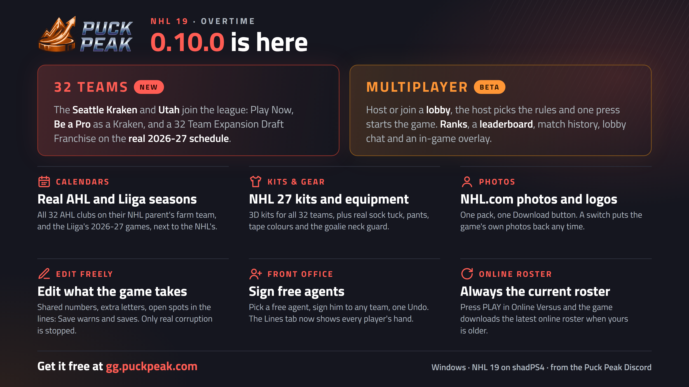
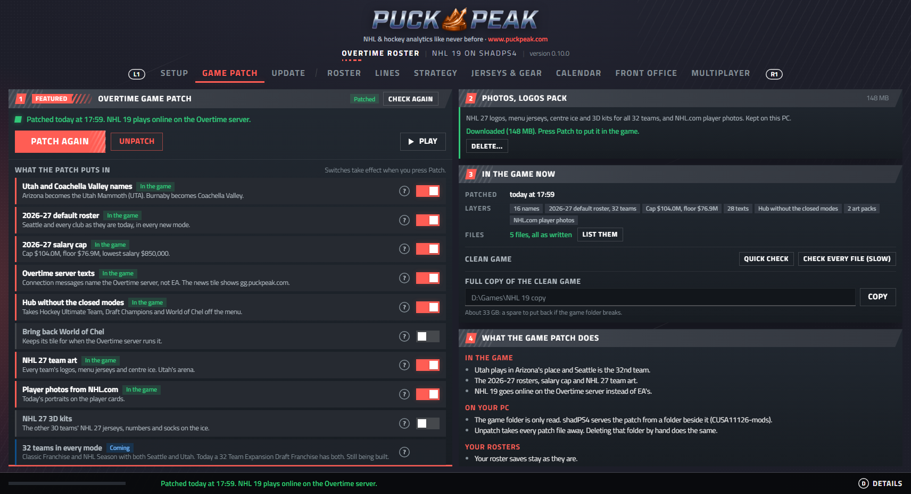
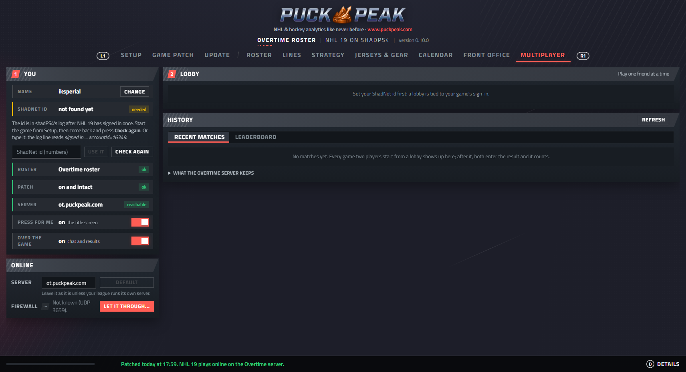
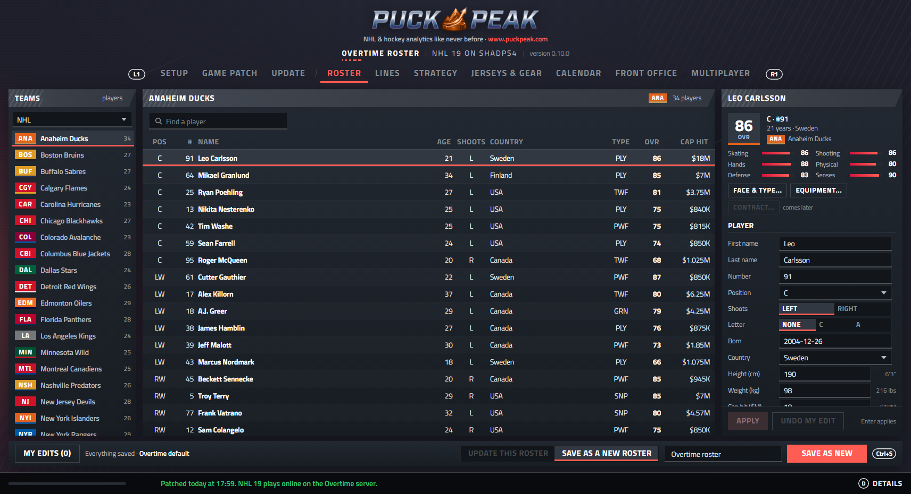
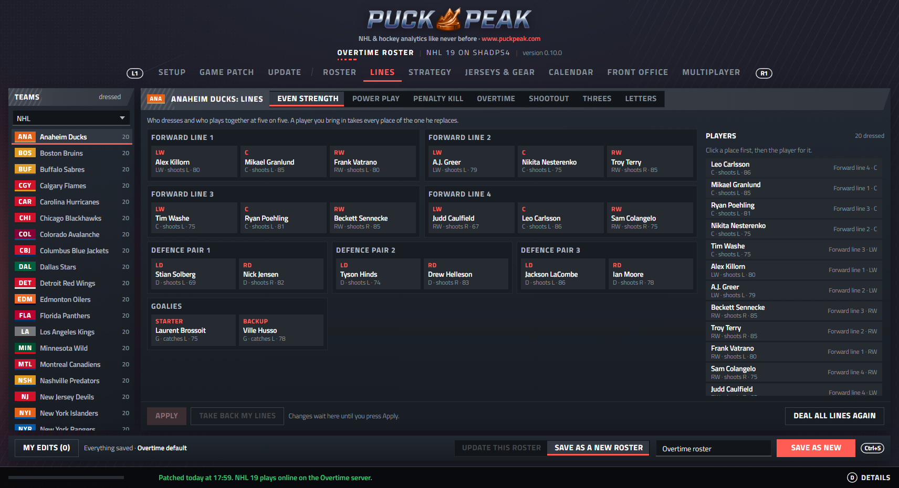
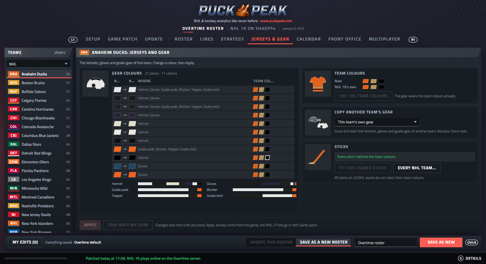
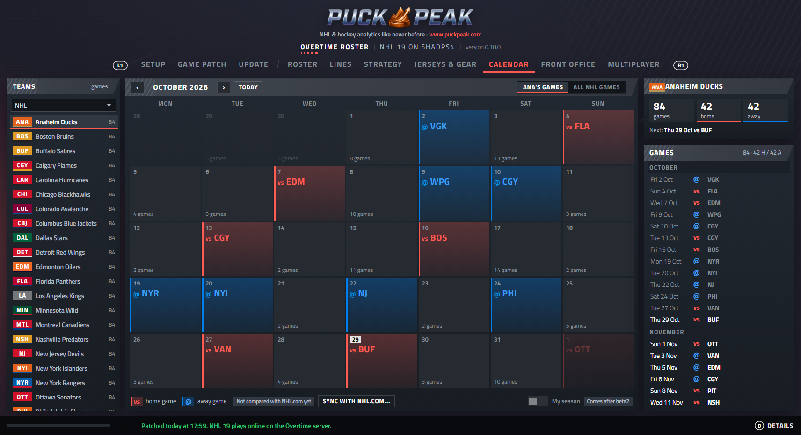
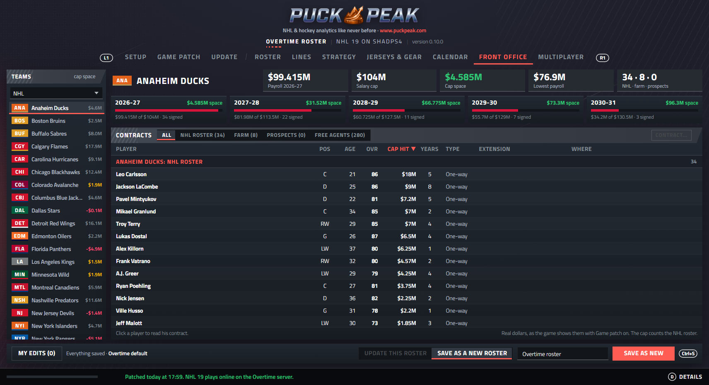
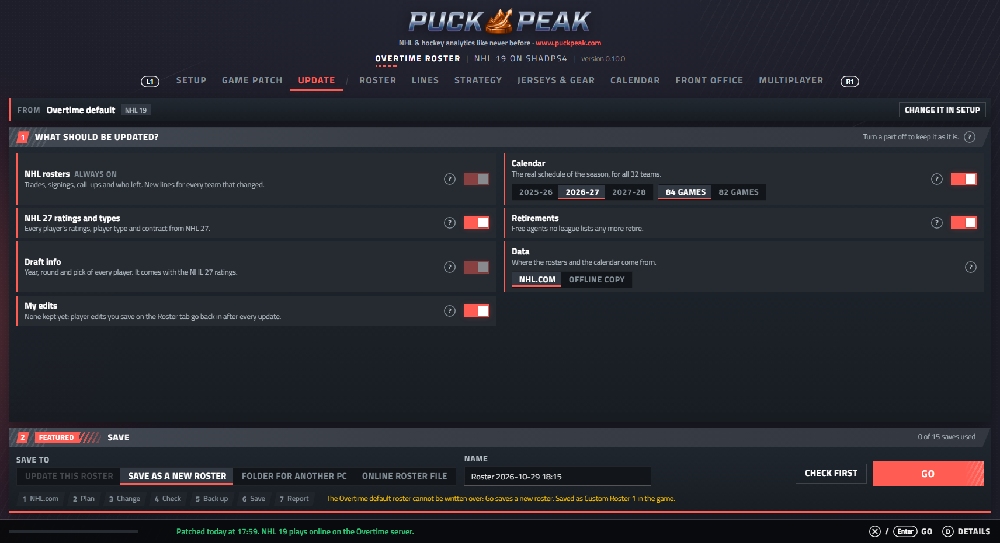

# 🏒 Puck Peak Overtime for NHL 19

### Online play and today's NHL for **NHL 19** on PS4 / shadPS4.
*One click patches your game: 32 teams, the 2026-27 season and a community server to play on.*

[**⬇ Download the latest version**](../../releases/latest)
&nbsp;·&nbsp; [Quick start](QUICKSTART.md) &nbsp;·&nbsp; [What's new](CHANGELOG.md)

Questions, news and help: **[gg.puckpeak.com](https://gg.puckpeak.com)**

## ✨ Highlights

- 🌐 **Online again.** EA switched NHL 19's servers off. The game patch points NHL 19 at the Overtime community server,
  so Online Versus works again. The game downloads the current online roster by itself, so both players play the same
  one.
- 🎮 **Multiplayer (closed beta).** Host or join a lobby, the host picks the match rules (Competitive, Full Sim,
  Continuous OT, ...), and one press starts the game. You get ranks, a leaderboard, match history, lobby chat and an
  in-game overlay.
- 🏟 **32 teams.** The Seattle Kraken and Utah join the league: in Play Now, in Be a Pro (a career as a Kraken) and in a
  32 Team Expansion Draft Franchise.
- 🗓 **The real 2026-27 calendars.** The NHL, all 32 AHL clubs on their NHL parent's farm team, and the Liiga. They
  travel with the roster into Franchise and Season, and show month by month in the app.
- 👕 **NHL 27 kits and equipment.** 3D kits for all 32 teams, plus real sock tuck, pants, tape colours and goalie neck
  guards.
- 📸 **NHL.com photos and logos.** One optional pack, one Download button. A switch puts the game's own photos back.
- ✏️ **A full Roster editor.** Players, numbers, ratings, lines, strategies, jerseys and gear, contracts and the salary
  cap, and signing free agents. You can edit freely: Save stops only what would corrupt the roster or crash the game.
- 🔒 **Safe.** Your game files are never changed, every save is backed up first, and **Unpatch** puts everything back.
- 🔄 **Stays fresh.** It checks for new versions itself.

 
 
 
 

## 🚀 Get started

1. Download `OvertimeNHL19.exe` (Windows 10 or 11) from the [release page](../../releases/latest). Windows SmartScreen
   warns because the exe is not signed: choose **More info**, then **Run anyway**.
2. In **Setup**, check that it found shadPS4 and NHL 19 (or pick them). In **Game patch**, press **Patch**.
3. Start NHL 19 from shadPS4. That is all. **Unpatch** takes everything out again.

Step-by-step, with what you need first: [QUICKSTART.md](QUICKSTART.md).

## What you need

- Your own NHL 19 dump: **CUSA11126, update 1.60**. The app refuses other versions.
- **shadPS4, NHL19-Build** ([Kravickas/shadPS4, branch NHL19-Build](https://github.com/Kravickas/shadPS4/tree/NHL19-Build)).
  The app finds it but never downloads it.
- For online play: a **ShadNet** account, signed in inside shadPS4.

## How it works

| Part | What it does |
|---|---|
| `overtime_roster/` | The desktop app **Overtime Roster** (pywebview + `web/`): setup, game patch, roster update and editor, multiplayer |
| `overtime_core/` | The NHL 19 roster codec, schema, verify rules, calendars, art packs and the shadPS4 patch builder |
| `patches/`, `client/` | The shadPS4 patch that points the game at the Overtime server, and the replacement connection texts |
| `packaging/` | The PyInstaller build of `OvertimeNHL19.exe` |

The eboot patch goes into shadPS4's patch folder and the data changes into an overlay folder next to the game. The game
folder itself is only ever read. The roster app reads the game's own data from your copy at runtime.

For developers: [AGENTS.md](AGENTS.md).

## What this project does not ship

No game files, eboot, archives, certificates or extracted EA assets are in this repository. You need your own legally
obtained copy of NHL 19.

## Disclaimer

Overtime is an unofficial fan project by [Puck Peak](https://www.puckpeak.com). It is not affiliated with, endorsed
by or sponsored by Electronic Arts, EA SPORTS, the NHL, the NHLPA, the AHL, the Liiga or any team. All trademarks
belong to their owners. No money is made from this project. Official AHL statistics are provided by the American
Hockey League.

## License

[MIT](LICENSE). Bundled: React and htm (MIT, `overtime_roster/web/vendor/LICENSES.txt`) and the Titillium Web font (SIL Open Font License,
`overtime_roster/web/fonts/OFL.txt`).
